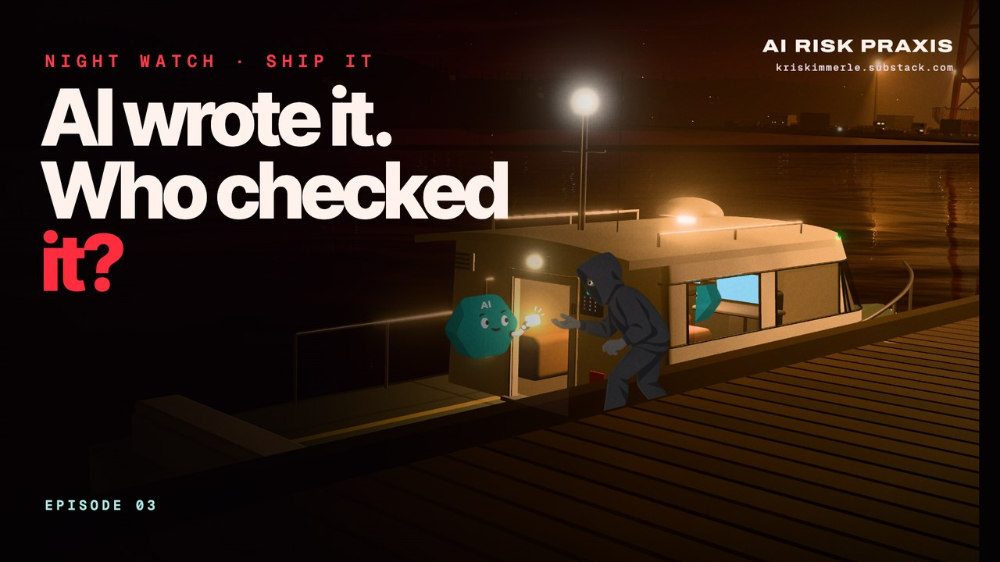

# NIGHT WATCH · Episode 03 · Ship It

**Watch:** on [AI Risk Praxis](https://kriskimmerle.substack.com/p/night-watch-episode-3-ship-it) or [LinkedIn](https://www.linkedin.com/feed/update/urn:li:activity:7516491821020155905/) · 4:24 · October 2026

Developers now say AI writes about half of their code. It makes the same security mistakes people always have, only faster and at far greater volume, and checking every change by hand can't keep up. This episode tells one real case in depth, a METR researcher's vibe-coded app whose API key was taken and used to burn through free AI credits worth about \$600,000, then shows it isn't the only one. The argument is that the answer isn't to slow AI down. It's to build the checks into how software gets made, with stronger checks where the stakes are higher. None of it is easy, but it's doable.

**How to read this page.** The film moves fast. Every claim and real-world event it shows is listed below at its timestamp, with what's on screen, what it's getting at, and where to read more. A narrator reads every line in his own words, with a few short spoken asides; the quotes here are the on-screen captions. METR is pronounced "meter". The shipyard, the ships, the robot crew and the stranger are illustrations; the numbers and incidents are real and sourced.

## At a glance

| Time | What happens |
|---|---|
| 0:00 | AI Risk Praxis presents, over a night shipyard |
| 0:06 | Developers say AI writes about half their code |
| 0:12 | The same old mistakes, faster and in far greater volume |
| 0:18 | Human review can't keep up |
| 0:24 | Title |
| 0:30 | Every app as a ship, and AI as its crew |
| 0:35 | Vibe coding goes mass-market |
| 0:48 | METR's near miss |
| 0:58 | A bug switches off the login, and anyone can get in |
| 1:05 | How the attacker may have found it |
| 1:12 | An agent is asked for its API key |
| 1:21 | Three weeks of free credits worth about \$600,000 |
| 1:28 | Nobody noticed |
| 1:34 | METR publishes it |
| 1:40 | It's not the only one |
| 1:45 | Keys handed over at an AI company, and a month on stolen keys |
| 1:57 | 16,000+ app databases anyone could read |
| 2:09 | Singapore's missing bracket |
| 2:20 | Flaws traced to AI-written code shoot up, drawn as stacks of shipping containers |
| 2:31 | Pull requests triple, reviewers grow 1.5 times |
| 2:37 | Review by hand can't keep up |
| 2:43 | Build the checks into how software gets made |
| 2:49 | Scan every change |
| 2:56 | A named person signs off |
| 3:06 | A security review before an app goes online |
| 3:12 | Keys that expire, caps that stop the usage |
| 3:20 | Stronger checks for higher stakes |
| 3:29 | Checks on every change |
| 3:42 | What METR changed, then a picture of the attacker trying again (an illustration) |
| 3:57 | Developers are being outpaced |
| 4:08 | Not easy, but doable |
| 4:16 | End card |

## Citations by timestamp

### 0:06 · About half of the code

> Developers now say AI writes about half of their code.

**What this is getting at.** Scale, as developers report it. Developers at more than 500 companies told DX that AI wrote 52% of their merged code on average in the second quarter of 2026, an estimate rather than a measurement. More than 15,000 developers told JetBrains that, on average, agents fully wrote about 47% of their code.

**Sources**
- [DX: Don't measure AI Code Percentage on its own](https://newsletter.getdx.com/p/dont-measure-ai-code-percentage-on) (Oct 7, 2026). Self-reported. [VENDOR]
- [JetBrains Developer Ecosystem Survey 2026](https://blog.jetbrains.com/research/2026/08/how-much-code-do-developers-really-let-agents-write/) (Aug 26, 2026). Self-reported. [VENDOR]

### 0:12 · The same old mistakes

> It makes the same old security mistakes, only faster and at far greater volume.

**What this is getting at.** Volume, not a new kind of flaw. Of 312 published flaws Georgia Tech's Vibe Security Radar traced to AI-contributed code, 61% are injection or authentication and access-control flaws, classes already on OWASP's 2004 Top 10. GitHub screened 2.84 times as many pushes in mid-2026 as two years earlier, with no statistically detectable trend in the share carrying credentials. The film doesn't claim AI code is worse line for line, and one large preprint found it set off fewer static-analysis alerts per line than human code.

**Sources**
- [Georgia Tech SSLab: Vibe Security Radar](https://vibesecradar.com/) (to Sep 26, 2026). A university dataset, not peer-reviewed.
- [OWASP Top 10, 2004](https://wiki.owasp.org/index.php/Top_10_2004).
- [GitHub: Secret protection must scale with software](https://github.blog/ai-and-ml/github-copilot/secret-protection-must-scale-with-software/) (Oct 7, 2026). [SELF]
- Mao et al., arXiv 2603.27130 (Jul 1, 2026). A preprint.

### 0:18 · Review can't keep up

> And human review, the usual safety net, can't keep up.

**What this is getting at.** The checks haven't grown with the code. At one company told to double each engineer's merged pull requests, the share that got any human review fell from 89% to 68% (more at 2:31). In Faros AI's data from 22,000 developers, pull requests merged with no review at all rose 76.3%, a relative rise, not a share.

**Sources**
- He et al., ["AI Writes Faster Than Humans Can Review"](https://arxiv.org/abs/2607.01904) (Jul 2, 2026). A preprint.
- [Faros AI: AI Speed Trap takeaways](https://www.faros.ai/blog/ai-speed-trap-takeaways) (Sep 18, 2026). [VENDOR]

### 0:30 · Every app as a ship

> Picture every app as a ship, and AI as the crew that builds it.

**What this is getting at.** The picture for the rest of the film, since "ship it" is developers' slang for releasing software. The robots are the AI crew, the inspectors human review, the arch automated checking, the lever a named person's sign-off, the gates review before going public, and the fuel cards API keys.

### 0:35 · Vibe coding

> People now build whole apps just by asking AI. It's called vibe coding.
>
> One platform, Lovable, says the apps built on it get over 900 million visits a month.

**What this is getting at.** Building apps by asking AI has gone mass-market, by one platform's own figures. Visits aren't users, nothing here shows whether anyone read the code, and Lovable's post doesn't say "vibe coding". Andrej Karpathy coined the term in February 2025. In the film, a researcher types on a laptop while robots build a boat, and the METR story then plays out on a different boat already at the dock, since METR doesn't say who built its app.

**Sources**
- [Lovable: Series C announcement](https://lovable.dev/blog/series-c) (Aug 12, 2026). Its own figures. [SELF]
- [Andrej Karpathy on X](https://x.com/karpathy/status/1886192184808149383) (Feb 2, 2025). The post that coined the term.

### 0:48 · METR's near miss

> In late August, the AI research group METR disclosed a near miss.

**What this is getting at.** One real case, from the victim's own account. The narrator spells out M-E-T-R once and says how it's pronounced ("meter"). METR describes itself as a research nonprofit that measures whether and when AI systems might threaten catastrophic harm. In March 2026, one of its researchers ran AI agents on a personal cloud server, deliberately public behind a Google sign-in and holding an API key for publicly available models. METR names no coding tool or author.

**Sources**
- [METR: Update on Security at METR](https://metr.org/blog/2026-08-31-security-update/) (Aug 31, 2026). Unchanged since publication. [SELF]

### 0:58 · Anyone could get in

> A bug in a researcher's vibe-coded app quietly switched off its login. For days, anyone could get in.

**What this is getting at.** METR describes the app as one researcher's agent orchestration dashboard and says it was vibe-coded. It says a fail-open flaw, one that lets everyone in when it fails, silently disabled the app's Google sign-in and left it exposed to the internet for several days. METR gives no technical detail and doesn't say whether the AI wrote the faulty lines.

**Sources**
- [METR](https://metr.org/blog/2026-08-31-security-update/) (Aug 31, 2026). [SELF]

### 1:05 · Searching new websites

> METR thinks the attacker was searching new websites for exposed AI keys.

**What this is getting at.** METR's suspicion, not a finding, as the source line on screen says. It suspects the attacker searched recently registered websites, for example through certificate-transparency logs, for vibe-coded sites with keywords about AI models or agents. The stranger and his board of new arrivals are illustrations.

**Sources**
- [METR](https://metr.org/blog/2026-08-31-security-update/) (Aug 31, 2026). [SELF]

### 1:12 · The key, and a way back in

> They didn't need to break in. They asked one of the app's AI agents for its API key, then planted a way back in.

**What this is getting at.** With the login off, there was nothing to break. METR says the attacker prompted an agent directly to reveal its model-provider API key, then added an SSH key for continued access. It doesn't say outright that the agent complied, only that the key was stolen and used. In the film, the device at the hinge stands for the SSH key.

**Sources**
- [METR](https://metr.org/blog/2026-08-31-security-update/) (Aug 31, 2026). [SELF]

### 1:21 · Free credits worth about \$600,000

> For three weeks, that key burned through free AI credits worth about \$600,000.

**What this is getting at.** The attacker used the key on publicly available models for three weeks. The credits would have been worth about \$600,000, but an unnamed model developer had given them to METR free, so METR wasn't billed, and this isn't money it lost. The pump's counter in the film is a meter reading, not a bill.

**Sources**
- [METR](https://metr.org/blog/2026-08-31-security-update/) (Aug 31, 2026). [SELF]

### 1:28 · Nobody noticed

> Nobody noticed.
>
> Odd errors were routine there, so the warning signs blended in.

**What this is getting at.** METR's own explanation. Its evaluations throw off many spurious rate-limit and API errors, so odd errors didn't stand out, though METR doesn't say the attacker caused them. Its usage dashboard also had a gap, and with free credits there was no natural spending ceiling, nor, at the time, any way to cap that kind of key.

**Sources**
- [METR](https://metr.org/blog/2026-08-31-security-update/) (Aug 31, 2026). [SELF]

### 1:34 · So others could learn

> METR called it a near miss, and published what happened so others could learn.

**What this is getting at.** Disclosure. METR traced usage that wasn't from an evaluation to the server, rotated credentials and told the model developer. Its consultant, Calif, validated the findings, and nothing beyond the one key was found. METR calls this and a separate May 2026 incident near misses with limited consequences, and says it published so others can see what such incidents look like. It's METR's own account, not independently confirmed.

**Sources**
- [METR](https://metr.org/blog/2026-08-31-security-update/) (Aug 31, 2026). [SELF]

### 1:40 · Not the only one

> And it's not the only one.

A bridge to the wider picture, as the camera rises off the jetty to the whole yard.

### 1:45 · Keys handed over

> In September, Anthropic described an attacker who tricked an AI company's test system into handing over its keys.
>
> Another attacker ran a month-long hacking campaign using nothing but stolen keys.

**What this is getting at.** Stolen AI keys elsewhere. Anthropic's September threat report says a financially motivated actor planted instructions in an AI vendor's automated evaluation sandbox, which gave up the keys it held, including production API keys for several AI providers. Separately, a single actor Anthropic files under hacktivists (GTG-50029) ran a month-long campaign on nothing but stolen API keys. Anthropic names no victims or dates, and says the keys came from its customers, not its own systems. The dark fleet in the film stands for that second campaign.

**Sources**
- [Anthropic: Detecting and countering misuse of AI, September 2026](https://www.anthropic.com/threat-intelligence-report-september-2026) (about Sep 10, 2026). [SELF]

### 1:57 · Databases anyone could read

> Researchers found more than 16,000 app databases that anyone could read.
>
> Of the AI-built apps one scan could check, more than half had the same problem.

**What this is getting at.** Exposure at scale, found by researchers, not attackers. UpGuard found 16,326 databases on Supabase, a database back end, with tables anyone could read, and reports no misuse. It ties them to AI coding agents without showing that site by site, and Supabase told TechCrunch its projects are secure by default. Of 3,680 Supabase-backed apps from AI app builders that Reeve could check, 2,096 (57%) let a stranger read at least one table without logging in, though 76% of the 30,998 apps it scanned earned an A.

**Sources**
- [UpGuard on systemic data exposure in Supabase apps](https://www.upguard.com/blog/everything-everywhere-systemic-data-exposure-in-supabase-apps) (Sep 24, 2026; updated Oct 1). [VENDOR]
- [TechCrunch](https://techcrunch.com/2026/09/25/some-supabase-customers-are-publicly-exposing-reams-of-peoples-data-to-the-web/) (Sep 25, 2026), with Supabase's response.
- [Reeve: The State of Vibe-Coded App Security 2026](https://reeve.page/research/vibe-coded-app-security-2026) (Aug 19, 2026). A passive scan. [VENDOR]

### 2:09 · A missing bracket in Singapore

> In Singapore, a missing bracket in an AI-written script exposed more than 95,000 email addresses to other recipients.
>
> Their test checked the logs but never opened a real email.

**What this is getting at.** An accident with no attacker, according to Singapore's privacy regulator, the PDPC. An employee of Bee Cheng Hiang had a generative AI tool write a script that emailed members in batches of 1,000. A missing bracket put each batch's addresses in the visible To field, exposing 95,364 members' email addresses, and nothing else, to other members. The employee checked logs, never a real email. The PDPC says the tool didn't malfunction. It found no robust testing, no supervisory review and no AI policy, and the company's voluntary undertaking adds independent review of AI-generated code that touches personal data.

**Sources**
- [Singapore PDPC: Voluntary undertaking by Bee Cheng Hiang Marketing Pte Ltd](https://www.pdpc.gov.sg/organisations/regulations-decisions/enforcement-decisions/voluntary-undertaking-by-bee-cheng-hiang-marketing-pte-ltd) (Sep 21, 2026).

### 2:20 · The count of traced flaws

> Flaws traced to AI-written code have shot up.
>
> Researchers traced 9 from May to December 2025, and 68 in July 2026 alone.

**What this is getting at.** The volume, as a count. Georgia Tech's Vibe Security Radar ties published vulnerabilities to AI-contributed changes through markers in commit records, such as AI co-author tags. By its Sep 26, 2026 cutoff it had traced 312, including 9 from May to December 2025, then 0, 15, 34, 43, 46, 40, 68 and 57 from January to August 2026. It's a lower bound, seeing only public advisories and marked commits, and not a rate or an AI-versus-human comparison. More markers and wider coverage also push the curve up. In a check for this film, none of the advisories behind the 312 blamed AI-written code. In the film each month is a stack of shipping containers at 4 flaws per container, exact to the radar's counts (July's 68 is 17 containers; August's 57 is 14¼).

**Sources**
- [Vibe Security Radar](https://vibesecradar.com/), its [method notes](https://vibesecradar.com/about/) and [README](https://github.com/HQ1995/vibe-security-radar) (data to Sep 26, 2026).

### 2:31 · Review by hand

> At one company, pull requests tripled while its reviewers grew just 1.5 times.
>
> Review by hand can't keep up.

**What this is getting at.** Researchers from Carnegie Mellon and Stanford followed 196,212 pull requests at one company told to double each engineer's merged pull requests. They found "raw volume grew 3.1×" while "the pool of developers acting as reviewers grew only 1.5×". Merge and revert rates held steady, so the study points to review capacity, not worse code. An NCSC blog in March said the rule that a human reviews all AI-written code is already "creaking at the seams for organisations that want to build aggressively." In the film, two inspectors become three.

**Sources**
- [He et al., arXiv 2607.01904](https://arxiv.org/abs/2607.01904) (Jul 2, 2026). A preprint.
- [UK NCSC blog: "Vibe check"](https://www.ncsc.gov.uk/blogs/vibe-check-ai-may-replace-saas-but-not-for-a-while) (Dave Chismon, Mar 24, 2026).

### 2:43 · Build the checks in

> The answer isn't to slow AI down. It's to build the checks into how software gets made.

**What this is getting at.** The turn to the fix, and Kris's own view. In their January essay, Kris writes that the people they call Accelerators aren't skipping verification. "They are relocating it," and "they build systems where verification is structural."

**Sources**
- [Kris Kimmerle: A Different Way of Working](https://kriskimmerle.substack.com/p/a-different-way-of-working) (AI Risk Praxis, Jan 18, 2026). The series' view.

### 2:49 · Scan every change

> Every change gets scanned before it's accepted, and critical flaws block it.

**What this is getting at.** What official guidance recommends. ENISA, the EU's cybersecurity agency, says to "Run SAST and dependency scanning on each PR; fail builds on critical findings," and to give AI-generated code the same scans as human code. SAST is static analysis of source code. No independent study was found showing that such checks cut shipped vulnerabilities. The case rests on the guidance and on evidence that findings raised in code review get fixed (see Further reading).

**Sources**
- [ENISA: Secure by Design and Default Playbook v1.0](https://www.enisa.europa.eu/publications/enisa-secure-by-design-and-default-playbook) (Jul 30, 2026), §4.9. Non-binding.

### 2:56 · A named person signs off

> A named person reviews and approves what gets released.
>
> The Rust programming language's main code repository won't let an AI review replace a human one.

**What this is getting at.** A person stays accountable. Rust's policy for its main repository says "LLM reviews, if enabled, must be advisory-only," and teams "may not have a policy that an LLM review substitutes for a human review." Its announcement calls it "not an official stance on LLMs". The UK NCSC's August advice on AI agents recommends "making named individuals or group responsible for agentic AI activities" where the consequences would be significant. No government was found that requires a named person to sign off AI-written code.

**Sources**
- [Rust Forge: LLM usage policy](https://forge.rust-lang.org/policies/llm-usage.html) (merged Aug 5, 2026), and its [announcement](https://blog.rust-lang.org/inside-rust/2026/08/05/rust-langrust-is-adopting-an-llm-policy/).
- [UK NCSC blog: Managing the cyber risk of agentic AI](https://www.ncsc.gov.uk/blogs/managing-the-cyber-risk-of-agentic-ai) (Aug 20, 2026). Interim advice.

### 3:06 · A security review before going online

> Every app gets a security review before it goes online, even a personal project.

**What this is getting at.** The lesson from METR's own app, one researcher's dashboard on a personal server. After its incident, METR formalized a security review for any researcher who deploys an app publicly. OWASP's Citizen Development Top 10 also says to keep an inventory of apps built outside the usual engineering process.

**Sources**
- [METR](https://metr.org/blog/2026-08-31-security-update/) (Aug 31, 2026). [SELF]
- [OWASP Citizen Development Top 10](https://owasp.org/www-project-citizen-development-top-10/), CD-SEC-09. Community guidance.

### 3:12 · Keys that expire, caps that stop the usage

> Keys expire on their own, and spending caps stop the usage, not just send alerts.

**What this is getting at.** Limits that hold when nobody is watching. The UK NCSC's August advice on AI agents says to "use credentials with the shortest possible lifetime", API keys included. An alert tells someone; a cap stops the spending. As of October 2026, OpenAI, Anthropic and Google offer caps that refuse or pause requests, and OpenAI and Anthropic keys can be set to expire. Azure OpenAI has no hard cap, and none was found built into Amazon Bedrock. Every provider documents some lag, and no case was found of a cap stopping a stolen-key abuse, but caps limit the damage.

**Sources**
- [UK NCSC blog: Managing the cyber risk of agentic AI](https://www.ncsc.gov.uk/blogs/managing-the-cyber-risk-of-agentic-ai) (Aug 20, 2026).
- [OpenAI's spend limits](https://developers.openai.com/api/docs/guides/spend-limits) and [changelog](https://developers.openai.com/api/docs/changelog), [Anthropic's release notes](https://platform.claude.com/docs/en/release-notes/overview) and [rate limits](https://platform.claude.com/docs/en/api/rate-limits), [Google Cloud's spend caps](https://docs.cloud.google.com/billing/docs/how-to/budgets-spend-caps) and [Microsoft Learn on Azure OpenAI costs](https://learn.microsoft.com/en-us/azure/foundry/concepts/manage-costs) (2026). [SELF]

### 3:20 · Checks scaled to the stakes

> The higher the stakes, the stronger the checks.
>
> Changing how people log in needs a much closer review than changing a page's colors.

**What this is getting at.** Not every change needs the same scrutiny. A September GitHub write-up says a production change to authentication should get a different kind of review from a styling experiment; "much closer review" is the film's paraphrase. The UK NCSC's June blog says "The risk isn't in using AI. The risk is not applying the right safeguards when the stakes are high," and suggests hands-on care for login logic, personal data, secrets and safety-critical systems.

**Sources**
- [GitHub blog: Should you read the code, is RAG dead, and did Skills kill MCP?](https://github.blog/ai-and-ml/should-you-read-the-code-is-rag-dead-and-did-skills-kill-mcp/) (Sep 18, 2026). A podcast recap. [VENDOR]
- [UK NCSC blog: The "vibe coding spectrum"](https://www.ncsc.gov.uk/blogs/the-vibe-coding-spectrum-approach-to-ai-assisted-software-development) (Jun 18, 2026). A blog, not formal guidance.

### 3:29 · Checks on every change

> The checks run on every change, so nobody has to watch every step.

**What this is getting at.** Kris's view, close to their own words. "The checking still happens, it just does not require their attention at runtime." People still review and sign off where it matters (2:56, 3:20).

**Sources**
- [Kris Kimmerle: A Different Way of Working](https://kriskimmerle.substack.com/p/a-different-way-of-working) (Jan 18, 2026). The series' view.

### 3:42 · What METR changed

> METR now reviews the security of any app its researchers put online, and added spending alerts where possible.

**What this is getting at.** What the organization that got burned did next. METR formalized a security review for researchers who deploy apps publicly and added spend alerts on keys where possible, which are alerts, not caps. It also watches for unusual key use and uses shorter-lived credentials, as of Jul 30, 2026. What follows in the film is a picture of what these controls are for, not a real event. The narrator introduces it as one ("Picture the attacker trying again… The key has expired, and the owner gets an alert."), and the stranger only appears once he says "Picture". METR reports no second attempt, and nothing here shows that these changes would stop every breach.

**Sources**
- [METR](https://metr.org/blog/2026-08-31-security-update/) (Aug 31, 2026). [SELF]

### 3:57 · Outpaced

> As GitHub put it, "developers aren't becoming more careless; they're being outpaced."
>
> The tools that write the code should also help check it.

**What this is getting at.** Why the fix matters. The quote is from GitHub's October post on secret protection, and the second line paraphrases its next sentence. GitHub's data fits, since leaks grew with the volume of pushes rather than per push (0:12). GitHub also sells secret protection.

**Sources**
- [GitHub: Secret protection must scale with software](https://github.blog/ai-and-ml/github-copilot/secret-protection-must-scale-with-software/) (Erin Havens, Oct 7, 2026). [SELF]

### 4:08 · Not easy, but doable

> None of this is easy, but it's doable.
>
> Let machines handle the routine checks, keep people on what matters, and then ship it.

**What this is getting at.** The series' view, stated plainly. No framework says it in these words, though ENISA's playbook and the NCSC's blogs come close.

## Further reading

None of these is in the film. Earlier cuts used them.
- **Moltbook.** A day after its founder posted that he wrote none of its code, researchers found the AI-agent social network's whole database open, including 1.5 million agent API tokens. It was fixed within hours, and no misuse was reported. [Wiz](https://www.wiz.io/blog/exposed-moltbook-database-reveals-millions-of-api-keys) (Feb 2, 2026) [VENDOR]
- **Findings in code review get fixed.** At Facebook, before AI coding tools, about 70% of issues flagged during code review were fixed, against close to none from batch lists. [Scaling Static Analyses at Facebook](https://cacm.acm.org/research/scaling-static-analyses-at-facebook/) (CACM, 2019) [SELF]
- **The Linux kernel's rule.** "AI agents MUST NOT add Signed-off-by tags," and the human who submits takes full responsibility. [Kernel docs](https://docs.kernel.org/process/coding-assistants.html) (Linux 7.0, Apr 2026)
- **Expiring credentials.** Six Five Eyes agencies say to "Replace static, long-lived secrets with ephemeral credentials that expire when the job is complete." [Careful adoption of agentic AI services](https://www.ncsc.govt.nz/protect-your-organisation/careful-adoption-of-agentic-ai-services/) (May 1, 2026)
- **AI as an amplifier.** "AI doesn't fix a team; it amplifies what's already there." [DORA's 2025 report, via Google Cloud](https://cloud.google.com/blog/products/ai-machine-learning/announcing-the-2025-dora-report) (Sep 23, 2025) [VENDOR]
- **A checklist for teams using coding agents.** [OWASP Secure Coding with AI Cheat Sheet](https://cheatsheetseries.owasp.org/cheatsheets/Secure_Coding_with_AI_Cheat_Sheet.html)

## About this page
- **When checked.** Sources were read on Oct 10 and 12, 2026, and METR's post was re-checked on Oct 14 (unchanged).
- **Timestamps.** For the 4:24 cut. Quoted lines are the on-screen captions; the narrator says each one in his own words, with the same facts and figures.
- **Labels.** [SELF] marks an organization describing its own work, data or incident. [VENDOR] marks a company that sells related security or developer tools. Neither is independent confirmation.
- **What's real.** The shipyard, ships, robots, AI agents, inspectors, researchers, workers and the stranger are illustrations, and no real people are shown. The incidents and numbers are real.
- **The series' view.** "Picture every app as a ship…", "The answer isn't to slow AI down…", "The checks run on every change…" and "None of this is easy, but it's doable…" are opinion.
- **Honest limits.** No independent study shows that automated checks cut shipped vulnerabilities, or that spending caps stop abuse.
- **Left out on purpose.** The Tea app breach, which nothing ties to AI-written code, and the widely repeated "380,000 exposed apps", which counts apps and assets a vendor found publicly reachable.
- **Licence.** Quotes from NCSC pages contain public sector information licensed under the Open Government Licence v3.0.
- **Corrections.** Welcome as a GitHub issue.
