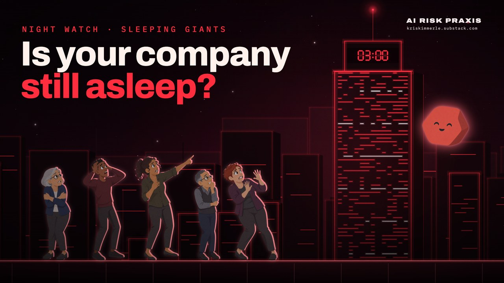
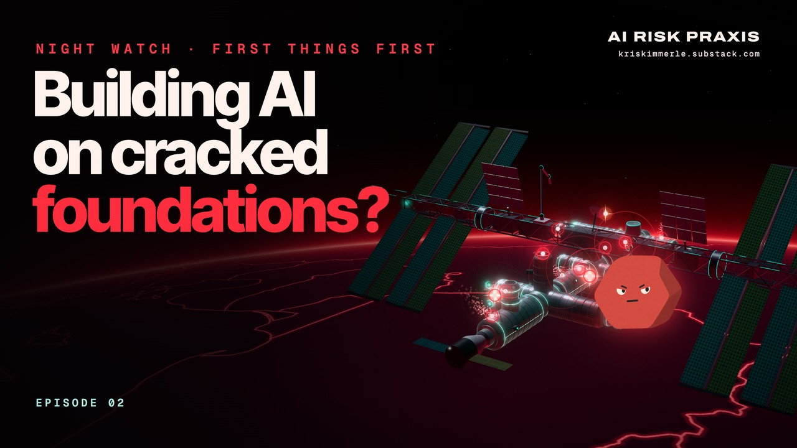

# NIGHT WATCH

Short motion films on AI and security, from [AI Risk Praxis](https://kriskimmerle.substack.com).

The films move fast. This repo is the slow version: each episode has its own folder with the citations for every real-world event and number on screen, mapped to the video's timestamps, plus a short take on what each moment is getting at and what to follow next.

## Episodes

| | Episode |
|---|---|
|  | **[01 · Sleeping Giants](01-sleeping-giants/)** 6:40 · Where we stand with AI and security: attacks got cheaper, the incidents piled up, and most companies are still asleep. |
|  | **[02 · First Things First](02-first-things-first/)** 4:05 · The AI attacks in the news still get in the old way. The foundations still work, and AI makes them matter more than ever. |
|  | **[03 · Ship It](03-ship-it/)** 4:24 · Developers say AI now writes about half of their code, and it makes the same old security mistakes faster than anyone can review them. The answer is to build the checks into how software gets made, with stronger checks where the stakes are higher. |
|  | **[04 · Hold the Line](04-hold-the-line/)** 7:44 · What AI guardrails are, why they can never catch everything, why they're still worth running, and how teams deploy them. |

## How the pages work
- Every claim on screen is listed at its timestamp, with links to the primary sources wherever they exist.
- Labels mark sources with an interest: [SELF] is a company describing its own work, and [VENDOR] is a security firm that sells related products.
- The characters, buildings, stations and swarms are illustrations. The incidents and numbers are real.

Spotted an error or a better source? Open an issue.
